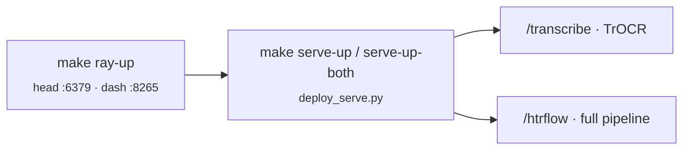

# Deployment

rask uses a **Helm chart at `chart/`** as the single deploy artifact for both
local k3s and production Kubernetes. The chart is the product (ADR 0153): it
renders rask's own services, zones and the objects they need, and installs no
operator or control plane. Those are prerequisites the platform runs, each in the
sections below; development installs them from `deploy/fixtures`, each its own
release, before rask's (`make k3s-up`).

## Prerequisites: the External Secrets Operator and a secret store

The chart takes **no credential as a value** ([[XC-004]]). Every secret lives in a store (the chart's dev
OpenBao, or the platform's OpenBao/Vault via `openbao.externalAddr`) and reaches a pod from it: through the
Dapr secret store for a pod with a sidecar, and through an ExternalSecret for one without. So the
**External Secrets Operator is a prerequisite**, platform-run like the store, and rask never installs it.
Install it on its own release first, at the version `deploy/fixtures/external-secrets/fixture.env` names (the one
rask is tested against; that fixture is also the development install `make k3s-up` runs).

Without it, `helm upgrade` and `make k3s-up` fail at render time with a message naming the operator. A
cluster-less `helm template` states the API it targets: `--api-versions external-secrets.io/v1/ExternalSecret`
(plus `--api-versions generators.external-secrets.io/v1alpha1/Password` for the dev OpenBao, whose
credentials ESO's Password generator creates in-cluster). A credential passed as a value is refused.

## Prerequisite: the Dapr control plane

rask's services talk to each other, publish and subscribe, hold actors and read secrets through Dapr sidecars, so a
**Dapr control plane is a prerequisite** (ADR 0153), installed once per cluster by the platform, as Dapr documents,
in `dapr-system`. The chart renders only rask's own Dapr objects (Components, Configurations, Resiliency,
Subscriptions) and the sidecar annotations; with `dapr.enabled` on it refuses to render for a cluster that does not
serve `dapr.io/v1alpha1` (a cluster-less `helm template` names it: `--api-versions dapr.io/v1alpha1`). Name the
control plane's namespace in `dapr.controlPlaneNamespace` (default `dapr-system`): the Collector scrapes it there,
and under NetworkPolicy every rask pod may reach it.

What the control plane must provide, and the version rask is tested against, are in `deploy/fixtures/dapr` (the
development install `make k3s-up` runs): Dapr 1.18.1; an injector that fails closed (`webhookFailurePolicy: Fail`)
scoped to pods labelled `dapr.io/enabled: "true"`, which rask stamps; no `dapr_rbac.secretReader`; Sentry mTLS on.
In production also HA (`global.ha.enabled`) and an injector that drops every sidecar capability
(`dapr_sidecar_injector.sidecarDropALLCapabilities`), the pair to rask's `dapr.sidecarRestricted`.

## Prerequisite: NATS JetStream

Every event rask moves (lineage, the medallion cascade, the catalog's control broadcast, the maintenance queues) rides Dapr pub/sub over **NATS JetStream, a prerequisite** (ADR 0153) the platform runs. The chart
renders no server; it renders what is rask's: the address its clients dial, the stream definitions (the stream Job,
which creates rask's streams on the bus as the `admin` user), and the bus users (`nats.auth.users`, one per app). Name
the bus in `nats.url` (the render refuses without it) and its HTTP monitor in `nats.monitorUrl` for the lakehouse ops
view. Each user's credential `nats-user-<user>` lives in the store; a store the chart does not seed needs them issued by
the bus's operator and attested with `nats.auth.provisioned` (docs/OPERATORS.md § 7).

What the bus must provide, and the version rask is tested against, are in `deploy/fixtures/nats` (the development
install `make k3s-up` runs, release `nats`, Service `rask-nats` in rask's namespace): NATS 2.14.2; JetStream on a file
store; a cluster of at least `nats.streamReplicas` nodes (three); operator mode with one APP account holding JetStream
and every rask user, so Dapr's pubsub.jetstream can authenticate with a user JWT and NKEY seed.

## Prerequisite: the CloudNativePG operator, for the AGE-on-CNPG path

The default graph store is the `rask-age` StatefulSet, which needs no operator. The AGE-on-CNPG path
(`age.cnpgCluster.enabled`, docs/CNPG-AGE.md) renders a CloudNativePG `Cluster`, so for it the **CloudNativePG operator
is a prerequisite** (ADR 0153): the chart installs no operator, and with `age.cnpgCluster.enabled` on it refuses to
render for a cluster that does not serve `postgresql.cnpg.io/v1` (a cluster-less `helm template` names it:
`--api-versions postgresql.cnpg.io/v1/Cluster`). The operator's CRDs belong to no Helm release: a release that owned
them would delete every CNPG CRD, and every `Cluster` with them, on uninstall.

The version rask is tested against is in `deploy/fixtures/cloudnative-pg` (the development install `make k3s-up` runs,
release `cloudnative-pg` in `cnpg-system`): chart 0.28.3, operator 1.29.1, CRDs applied server-side from
`chart/crds-bootstrap/` by `make k3s-crds` before it. The path itself needs CNPG >= 1.27 and Kubernetes 1.33+.

## Prerequisites in production: OpenFGA and its Postgres

The chart can run OpenFGA (the `openfga` subchart) and the Postgres behind the lineage graph, OpenFGA and the Dapr state
store (the `rask-age` StatefulSet). Development runs both. **Production names the platform's** ([[XC-132]], ADR 0153),
and `deploy/values-prod.yaml` turns both off (`openfga.enabled: false`, `age.enabled: false`):

- `auth.fgaApiUrl` is the platform's OpenFGA HTTP API. Every FGA client, the `openfga-model` hook and the
  bootstrap-admin Job dial it. Each one presents its projected ServiceAccount token: audience `rask-openfga`, issuer
  `auth.serviceAccountIssuer`, subject `system:serviceaccount:<namespace>:<release>-sa-<component>`. The platform's
  OpenFGA takes OIDC against that issuer, fetching its keys from the cluster's ServiceAccount JWKS. rask's issuer
  mirror and subject ConfigMap serve only the in-chart OpenFGA. The subjects to admit are the ones
  `lance.openfgaSubjects` (chart/templates/_helpers.tpl) computes for the overlay. A render with `openfga.enabled=true`
  prints them in the `<release>-openfga-authn` ConfigMap.
- `age.externalHost` is the platform's Postgres, which needs the Apache AGE extension (docs/CNPG-AGE.md) and the
  `lineage`, `openfga` and `daprstate` databases owned by `age.user`. Its password is the secret store's
  `postgres-password`, which ESO delivers, and the Dapr state store reads its whole DSN from the store's
  `dapr-state-connection-string` (`postgres://<age.user>:<password>@<age.externalHost>:<age.port>/<age.stateDb>`),
  which the platform writes beside it. No chart value carries either.

The render refuses either one when it is empty and its part is off. Under the production NetworkPolicy (default-deny egress), each endpoint needs a `networkPolicy.extraEgress` entry, as an external NATS or OTLP backend does. OpenFGA's own datastore, availability and
backups belong to the platform, so production runs no `pg_dump` CronJob.

## Development stand-ins

A real deployment brings its own identity provider, object store and secret store, and the chart takes them by
reference (`frontend.oidc.publicIssuer`, `dex.issuer`, `dex.clientId`; `minio.externalEndpoint` and the scoped
credentials; `openbao.externalAddr`).
Development runs stand-ins from `deploy/fixtures` (ADR 0153), and the chart renders none of them:

- **Dex** (`deploy/fixtures/dex`, release `dex`, Service `rask-dex`): the OIDC issuer with the demo users and rask's
  static client. `dex.enabled` says the estate uses it: the ingress serves it at `/dex`, the publisher's password is
  seeded into the dev store, and a real deployment's render refuses it.
- **MinIO** (`deploy/fixtures/minio`, release `minio`, StatefulSet and Service `rask-minio`): the S3 store, on the
  claims `data-<n>-rask-minio-<i>`. `minio.enabled` says the estate uses it: rask's dev store issues its root
  credential (`rask-infra-credentials`, through ESO), and rask's hooks provision its buckets and scoped users. Its
  server starts once rask is installed, so the fixture install does not wait for it.
- **OpenBao in dev mode** (`deploy/fixtures/openbao`, release `openbao`, Deployment and Service `rask-openbao`): the
  in-memory secret store. `openbao.enabled` with `devMode` says the estate uses it, and what goes into it stays rask's:
  the chart renders the seed scripts into `<release>-openbao-seed` (the dev credentials, every signing identity's
  Ed25519 pair, the bus trust root and users, ESO's policy), and the fixture's pod runs them beside the server. Without
  `devMode` the chart renders the sealed, file-backed server itself.

## Local deploy (k3s)

```bash
make k3s-install      # one-time: k3s + helm (sudo)
make k3s-build        # build fleet + frontend + ray images as :dev
make k3s-import       # side-load images into k3s
make k3s-up           # the fixtures (FIXTURES), each its own release, then helm upgrade --install rask ./chart --wait
# UI: http://rask.local/   API: http://rask.local/api/health
# (add "127.0.0.1 rask.local" to /etc/hosts)
make e2e              # verify MFE hydration + API round-trip end-to-end (run after k3s-up)
make k3s-down         # uninstall   |   make k3s-purge  # + delete PVCs
```

`k3s-build` builds the fleet (gateway, ray, controlplane) plus the frontend zone
images, the `ray-cluster` image, and the `lance-rest-catalog` lakehouse image as
`:dev` tags.
`k3s-import` side-loads them into k3s containerd via `docker save | ctr images
import`, so no registry is needed.

## Container images (`.docker/`)

Production-shaped image definitions live at `.docker/`, built with `docker buildx`
(repo root as context). Current:

| Image | Base | Notes |
|---|---|---|
| `rask-runner` | `nvidia/cuda:12.4.0-runtime-ubuntu22.04` | GPU. uv-managed Python + venv; `CMD ["runner"]`. Needs `--shm-size`, `--ulimit nofile=65535`, GPU via nvidia-container-toolkit. |
| `home` / `<domain>` (7 images) | build + serve on `oven/bun:1-debian` | All built from **one parametrized** `.docker/frontend.dockerfile` via `--build-arg APP=<dir>`. **SSR via `svelte-adapter-bun`** (no longer an nginx SPA). `APP=home` is the catch-all (owns `/`); the six domain apps (lakehouse/media/annotator/compute/train/studio) each pin a bare base `/<zone>` — **not** `/default/<zone>` — and the Ingress routes there with `pathType: Prefix` and **no** `rewrite-target`, so the pod receives the based path. Probes are **TCP, not httpGet**, because a zone's `/` 404s under its own base. Images are tagged `web-<zone>:<tag>`. Pre-builds `@rask/ui`, then `bun build`; the final stage ships the Bun runtime + `node_modules` and runs `bun build/index.js` on `:3000`. tini as PID 1, non-root UID 10001. |
| backend services (per-workload) | uv-managed Python | One dockerfile each: `gateway`, `ray` (plus `ray-cluster.dockerfile` for the Ray head/Serve image and `rest-catalog.dockerfile` for the lakehouse+media image). |

The one frontend dockerfile encodes a non-obvious build contract (documented in its
header): `svelte-adapter-bun` externalizes `@sveltejs/kit`, so the final
image must ship `node_modules` — `build/` is not standalone. And bun 1.3's **isolated
linker** keeps real packages in `node_modules/.bun/` with per-member symlinks, so the
final stage copies both the root store **and** the app dir (with its symlinks) and
runs from the app dir. The build `COPY`s the full JS workspace (all of
`frontend/microfrontends` wholesale + `packages/{api,ui}`) so `bun install` resolves — siblings
are build-stage only, never shipped.

!!! note "Frontend images aren't built by `.dagger`"
    The Dagger module covers Python CI only (`migrate-up`, `test-pg` — see
    [CI](#ci) below); it does **not** build or publish the `.docker/*.dockerfile`
    images. Those are built directly with `docker buildx`. Wiring the frontend (and
    service) image builds into Dagger or a GitHub Actions matrix is a
    deployment-cycle follow-up.

The dissolved `viewer` monolith no longer has a dockerfile; the surviving fleet
services ship their own (`gateway`, `ray`) — core-api/search-api/volumes-api's
dockerfiles died with their services in the R6/R20 wave.

The frontend topology those images serve — the Turborepo vertical-microfrontend
proxy, the shared `@rask/ui` shell, and per-app `kit.paths.base` — is documented in
the `rask-frontend` project skill (`.claude/skills/rask-frontend`).

## Ray cluster & Serve (local)



- `make ray-up` / `ray-down` / `ray-status` — local Ray head.
- `make ray-up-htr` — a **2-GPU pool pinned to GPUs 0,1** (`CUDA_VISIBLE_DEVICES=0,1
  --num-gpus=2`); exports `RAY_ENABLE_UV_RUN_RUNTIME_ENV=0` and uses
  `uv run --no-sync` (the documented Ray/uv gotcha).
- `make serve-up` / `serve-down` / `serve-status` — deploy the Serve apps via
  `scripts/deploy_serve.py`.
- `make serve-up-both` — deploy `transcribe` + `htrflow` with fractional GPU
  reservations (`RASK_SERVE_REPLICAS=2`, `RASK_SERVE_GPU_FRAC=0.49` → ≈1.96 GPU
  on the 2-GPU pool).
- `make qwen-serve` — an external vLLM LLM backend on GPU 2 (isolated venv,
  OpenAI-compatible API on `:8001`), separate from the HTR workspace.

## Remote KubeRay

The runner accepts `--address ray://…:10001`. Job submission goes through the **`compute`
service** (`:8804`, over `ray-kit`'s Job SDK wrapper) to the Ray dashboard REST API at
`RAY_DASHBOARD_URL`, which the chart renders on the compute pod alone. The medallion names no Ray: it hands a
work order to compute by Dapr service invocation (CP-056, ADR 0140). That address and the annotator's Serve
discovery come from one helper, `rask.rayDashboardUrl`, so `compute` prunes job history on the cluster it
submits to: `ray.dashboardUrl` names the engine, and left empty with an engine enabled
(`services.compute.engines`) the render fails. The chart installs no Ray (ADR 0153): no KubeRay operator, no
RayCluster or RayService. The engine owner runs Ray; in development `make k3s-up` installs the
`kuberay-operator` and `ray-cluster` fixtures (`deploy/fixtures`, not for production), whose head Service is
`rask-ray-head-svc`, and `deploy/values-local.yaml` names it. rask's side of the seam is the address, the
token its Ray clients present (`ray.auth.enabled`, `<release>-ray-auth-token`), and the engine identity its doors
admit as the trainer (`ray.engineServiceAccount`).

## Helm chart (`chart/`)

`make k3s-up` runs `helm upgrade --install rask ./chart --wait`. The chart deploys:

- **gateway** — reverse proxy on `:8888` (path-routes `/api/*`, no catch-all).
- **compute** — the Ray dashboard proxy and `/api/serve/*` on `:8804`, over the engine `ray.dashboardUrl` names.
- **controlplane** — project provisioning on `:8820`.
- **the lance planes** — catalog/lineage/medallion/compaction + the media trio
  (viewer/search/annotator; the viewer carries the S3 object browser).
- **frontend zones** — SvelteKit SSR apps on `:3000` each.
- **Ingress** (Traefik) — `/api` → gateway:8888, `/` → the zone services.
- **Optional, in-chart for development and the platform's in production** ([[XC-132]]): `openfga.enabled` (the
  OpenFGA subchart) and `age.enabled` (the apache/age Postgres StatefulSet); see *Prerequisites in production*.
- **Its own configuration of what it does not run**: the Dapr Components, Configurations and Resiliency, the NATS stream
  Job, the ExternalSecrets and SecretStore, the MinIO bucket and user hooks, and the dev OpenBao's seed scripts.
- **The OTel Collector**, with `observability.enabled` (see below).

Everything else is a separate release ([[XC-085]], ADR 0153). `make k3s-up` installs the development set from
`deploy/fixtures` first (`make k3s-fixtures`): the External Secrets Operator, Dapr, NATS, the CloudNativePG operator,
Dex, MinIO, OpenBao, the KubeRay operator and a Ray cluster, and the telemetry chain. A platform brings its own.

### GPUs are the engine's

The chart reserves no GPU and renders no Serve application: GPUs, a device plugin, the `nvidia` RuntimeClass and
each Serve replica's GPU fraction belong to the engine. In development the `ray-cluster` fixture's `gpuCount`
sizes its head, the `nvidia-device-plugin` fixture advertises `nvidia.com/gpu` on a node where nothing does yet,
and k3s creates the `nvidia` RuntimeClass itself (`deploy/fixtures/README.md`).

### StorageClasses: omit, don't guess

No template names a StorageClass. `rustfs.storageClass`, `ray.hfCacheStorageClass` and
`explorer.corpus.storageClass` all default to `""`, which omits `storageClassName` so the **cluster's
default** class provisions — the only portable answer (`local-path` is k3s's provisioner name and does not
exist on kind, whose default is `standard`). Note `storageClassName: ""` is *not* the same as omitting it:
the empty string disables dynamic provisioning, which is why the templates use `with`. No test pins it.

### Observability (`observability.enabled`)

rask's telemetry seam is one **OTel Collector** (`chart/templates/otel-collector.yaml`, `rask-otel-collector`),
the **single log shipper** (Vector retired, owner ruling 2026-07-27). It receives the fleet's OTLP, tails
infra-pod logs (filelog), scrapes the Dapr sidecars, the Dapr control plane, Ray and OpenFGA, and exports
everything over OTLP/HTTP to **`observability.export.endpoint`**, with the backend's ingestion headers from
`observability.export.{headers,traceHeaders,auditHeaders}` and HTTP basic auth from the store's
`otel-collector-export` secret (via ESO, as mounted files).

**The store, dashboards and alerting are a prerequisite, not part of the chart** (ADR 0153). A platform names
its OTLP backend in `observability.export.endpoint` (values-prod leaves it empty and the render refuses
that), the SQL/PromQL API the zones' audit viewer and experiment curves read in `observability.query.url`,
and loads rask's alert rules, **`deploy/alerting/rules.yml`** (Prometheus rule-file format; proven by
`make alert-rules-check` and replayed against GreptimeDB by `make alert-rules-drill`), into its own
evaluator. The store must meet the audit store's contract in `chart/values.yaml` `observability`.

**Development** gets the chain from the `observability` fixture (`deploy/fixtures/observability`, release
`observability` in namespace `observability`, installed by `make k3s-up`), which `deploy/values-local.yaml` names:

| Component | Version | Service | Role |
|---|---|---|---|
| **GreptimeDB** | `greptimedb-standalone` 0.4.5 (app 1.1.1) | `greptimedb.observability:4000` | Metrics/logs/traces store on a local volume: OTLP at `/v1/otlp`, PromQL at `/v1/prometheus`, SQL at `/v1/sql`; a retention Job sets the database and audit-table TTLs |
| **Perses** | 0.22.0 | `perses.observability:8080` | rask's dashboards-as-code over GreptimeDB's PromQL |
| **vmalert** | v1.106.1 | `observability-vmalert:8880` | Evaluates `deploy/alerting/rules.yml` (passed with `--set-file`) |
| **Alertmanager** | v0.28.0 | `observability-alertmanager:9093` | Groups and holds firing alerts (no receiver: pages nowhere) |

**App instrumentation:** `service_kit.setup_otel` instruments the FastAPI fleet —
the services built on `make_service_app` call it automatically, and the gateway
(a bespoke proxy app, no `Settings`) calls it directly with `service_name="gateway"`
so the front-door spans root every distributed trace. It wires both **traces** and **RED
metrics**: the FastAPI/HTTPX instrumentation emits `http.server.*`/`http.client.*` request count,
duration, and active-request metrics automatically. Every plane exports plain OTLP/HTTP to the
Collector (`OTEL_EXPORTER_OTLP_ENDPOINT`, `RASK_OTEL_ENABLED` when `observability.enabled=true`) and names
no store; the Collector adds the backend's headers. When the toggle is off the env vars are absent and
instrumentation is a no-op. Standard OTLP throughout; OTel-Arrow is not used (the Python SDK lacks OTAP support).

Greenfield local cutover (drops old PVCs): `make k3s-purge && make k3s-up`.

Sensitive config comes from an operator-created Secret (`existingSecret`, default
`rask-app`); non-sensitive config from `values.yaml` → ConfigMap. See
`chart/README.md`.

## CI

- **GitHub Actions** runs only `.github/workflows/docs.yml`: builds this Zensical
  site (`zensical build --clean`, with mkdocstrings API reference), builds
  Storybook, and deploys both to GitHub Pages on push to `main`/`master`.
- **Tests & migrations** run through **Dagger**, not GitHub Actions:
  `dagger call migrate-up` (alembic against an ephemeral Postgres — proof of a
  clean from-zero migration) and `dagger call test-pg` (migrate + core pytest).

## State stores

- **Postgres** (prod) via `DATABASE_URL=postgresql+asyncpg://…`; **SQLite** (dev)
  at `.cache/batches.db`. Schema changes go through **Alembic** — never
  `create_all` at startup. Local Postgres: `make pg-up` / `pg-migrate`.
- **S3** (backend-agnostic: MinIO / rustfs / AWS; HCP only as a legacy env-alias
  bridge) two-bucket setup (`images-batch` input, `images-batch-alto` output) plus
  the `images-batch-search` Lance tables.
