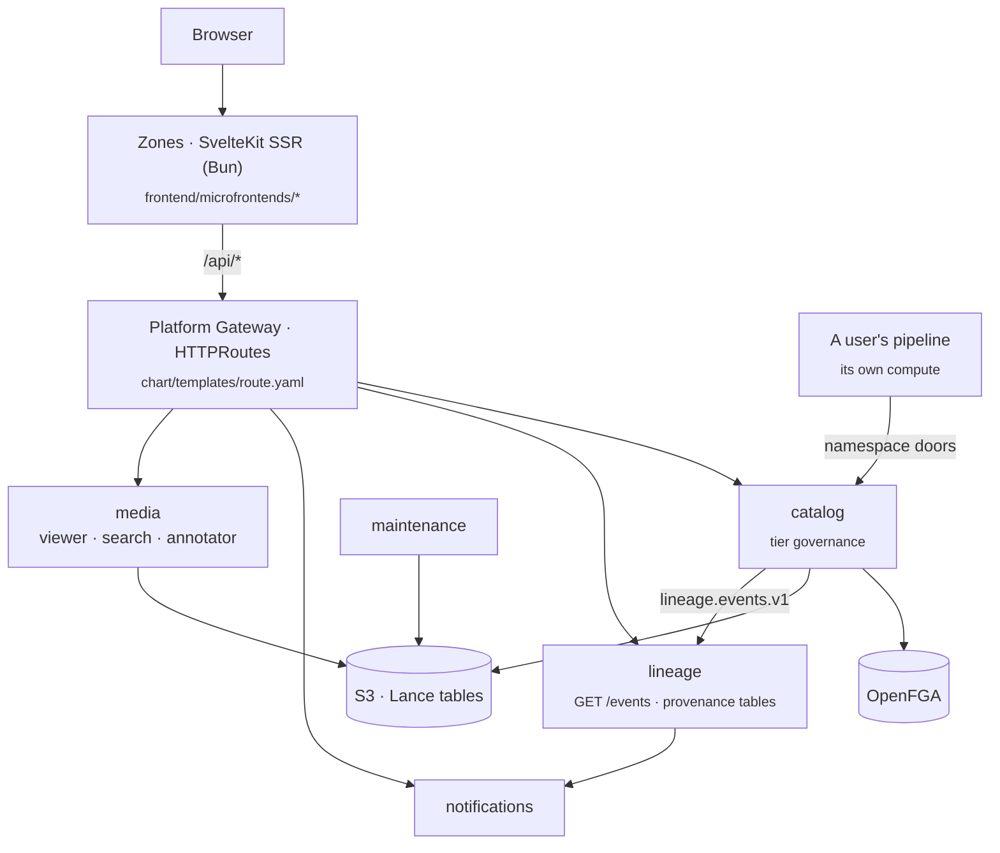

# Architecture Overview

rask is a data-type-agnostic, multimodal lakehouse: Lance tables governed by a catalog, with lineage, authorization,
events and annotation across them. This section describes the system as it runs today.

## One-paragraph summary

The **catalog** serves the Lance Namespace REST specification (`lance_docs/ns_catalog/spec.yaml`) over Lance datasets
on S3, organised as `project > warehouse > namespace > table`. Every write enters through its namespace doors, is
authorized on **OpenFGA**, and is governed in the catalog's write path, which is where the bronze → silver → gold
tiers live ([ADR 0155](../adr/0155-the-medallion-is-tier-governance-in-the-catalog.md)). The catalog announces each
committed write as an OpenLineage event over Dapr pub/sub on **NATS JetStream**; **lineage** records it in a durable
commit feed (`GET /events`) and a table-level edge list, Lance tables in the catalog's provenance namespace, and
forwards it to a bring-your-own graph backend ([ADR 0158](../adr/0158-provenance-is-a-service-the-lineage-graph-is-bring-your-own.md)), and
**notifications** turns the events into a per-person inbox.
**Maintenance** expires versions, purges trash, scans for orphans and reconciles stores. Moving data between tiers,
ingest and training are the user's pipeline, on the user's own compute and orchestrator
([ADR 0154](../adr/0154-the-lakehouse-runs-no-ingest-and-no-workflow-engine.md)). The HTTP backend sits behind the
**platform's Gateway** (Kubernetes Gateway API), whose HTTPRoutes the chart renders, one per public `/api/*` prefix
([ADR 0165](../adr/0165-the-edge-is-the-platforms-gateway-api.md)); seven **SvelteKit 2 + Svelte 5 SSR** zones (svelte-adapter-bun) consume it: a catch-all
`home` owning `/` plus `lakehouse`, `explorer`, `annotator`, `compute`, `models` and `studio`.

## Component map

## Key facts

- **The catalog is the only way in.** No lakehouse service fetches source bytes or writes a governed table except
  through the catalog's namespace doors, so tier governance cannot be bypassed. What it enforces today, and the
  ADR 0156 rules still to land, are in [Tier Governance](../TIER-GOVERNANCE.md).
- **The estate is authenticated.** Every service verifies an OIDC token (Dex in development) and authorizes on OpenFGA;
  the chart turns auth on by default and refuses a half-governed render. The frontend hits `/api/*` on the cluster
  route, which sends each prefix straight to its service; no process at the edge holds a token, so every 401 and
  403 comes from the service (SSR `load` uses the Gateway's in-cluster address, `RASK_EDGE_URL`, server-side).
- **Compute is bring-your-own.** The lakehouse imports no `ray`, `ray_kit` or `compute` (the import contract
  `the-lakehouse-knows-no-engine`). The `compute` service (Ray dashboard introspection and the Serve proxy) is the
  companion of a bring-your-own Ray engine and ships in its own chart, which publishes `/api/ray` and `/api/serve` with its own
  HTTPRoute. A workload's model environment is a sealed `runners/<workload>` project.
- **State** is the Lance tables on S3 (MinIO in development), lineage's among them, plus Postgres for OpenFGA and the
  Dapr state store. The
  Helm chart in `chart/` deploys rask's own services; Dapr, NATS, the object store, the secret store and the
  observability store are prerequisites the platform runs.

## In this section

- **[Monorepo Layout](layout.md)** — the two language-pure workspace planes and what lives where.
- **[Deployment](deployment.md)** — prerequisites, clusters, container images, CI, and how it ships.
- **[Ingest and Tier Movement](ingest-and-tier-movement.md)** — where data enters and who moves it between tiers.
