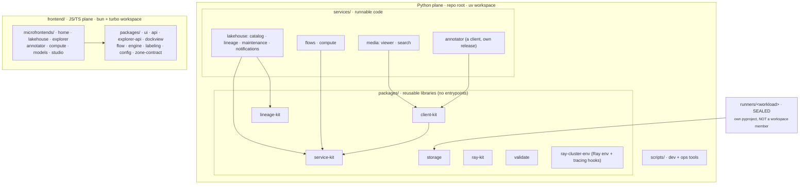

# Monorepo Layout

rask is a monorepo with two **language-pure planes** — Python at the repo root,
JS/TS under `frontend/`. Each plane is its own workspace root (uv for Python, Bun
+ Turborepo for JS/TS), and inside each plane the library/runnable boundary is
deliberate — don't blur it. Deployables build straight from the root uv workspace,
one `.docker/<name>.dockerfile` per deployable running `uv sync --frozen --package
<name>` against the root `uv.lock`.

## `packages/` — reusable libraries, no entrypoints

There are **two** `packages/` directories, one per plane: the root one is
Python-only, `frontend/packages/` is TS-only. Each is unambiguous from inside its
plane, and language purity is what lets both workspaces glob their members.

| Package | Language | Purpose |
|---|---|---|
| `packages/service-kit` | Python | Platform library: `make_service_app` app factory, `Settings`/config, exceptions, middleware, `get_settings`, injectable lifespan, plus the governed (`service_kit.governed`) and lakehouse (`service_kit.lakehouse`) seams. Dependency-light (no lancedb/ray/sqlmodel), and carries no code only a client runs. |
| `packages/client-kit` | Python | Code the lakehouse's clients share and the lakehouse never runs: the media app factory and lifespan, the lancedb dataset registry and descriptors, the per-route rate limiter. Used by viewer, search and the annotator; the lakehouse may not import it. |
| `packages/lineage-kit` | Python | The OpenLineage emission kernel and the Ed25519 signing and verifying seam for lineage events, used by catalog, lineage, maintenance and notifications. |
| [`packages/storage`](../packages/storage.md) | Python | The S3 client seam (`s3_client`, `configured_endpoint`, STS, the `StorageError` family) plus `FSSource/Sink`, `S3Source/Sink`, `iter_keys` and `build_source`/`build_sink`. |
| `packages/ray-kit` | Python | Ray Job SDK + dashboard wrapper (schemas, `build_client`, `RAY_TRANSIENT_ERRORS`, dashboard service). Used by the `compute` service only; the lakehouse may not import it. |
| `packages/validate` | Python | Pre-upload image validation over bytes or paths. |
| `packages/ray-cluster-env` | Python | The Ray images' platform environment and the tracing hooks the head and Serve are configured with (`ray_cluster_env.tracing`). |
| `frontend/packages/ui` | TS / Svelte | `@rask/ui`: Svelte 5 + Bits UI + Tailwind 4 component library with Storybook; `@rask/ui/shell` exports the shared `AppShell` every zone renders. |
| `frontend/packages/api` | TS | `@rask/api`: the typed `/api/*` client (relative paths; SSR rewrites them to `RASK_EDGE_URL`) plus the OIDC/BFF plane and the lineage client. |
| `frontend/packages/explorer-api` | TS | `@rask/explorer-api`: the Arrow-backed explorer/viewer client. |
| `frontend/packages/{dockview,flow,engine,labeling,config}` | TS | Workbench docks, the studio flow canvas, the annotation canvas, the `LabelOp` model and the shared `tsconfig`. |
| `frontend/packages/zone-contract` | TS | `@rask/zone-contract`: the estate's shape gates as a vitest suite (cross-zone `data-sveltekit-reload`, the zone manifest, deploy paths, the toolchain guard) plus the `make dev-zone` scripts. |

## `services/` · `frontend/microfrontends/` · `scripts/` — runnable code

| Path | Type | Purpose |
|---|---|---|
| `services/{catalog,lineage,maintenance,notifications}` | FastAPI | The lakehouse: the governed Lance Namespace catalog with tier governance, OpenLineage intake, the durable `GET /events` feed and edge list (Lance tables the catalog governs) and the forwarder to a graph backend, maintenance (expiry, purge, orphan scan, reconcile), and the targeted inbox. |
| `services/{viewer,search}` | FastAPI | The media plane (`:8101`–`:8102`, public `/api/explorer/*`). The viewer also serves the S3 object browser. |
| `services/annotator` | FastAPI | The labeling tool (`:8103`, public `/api/explorer/annotations`), a client of the lakehouse that reads and writes only through the catalog's doors; deployed by its own chart, `deploy/fixtures/annotator`, not the product chart (ADR 0171). |
| `services/flows` | FastAPI | The studio flow-builder's server half (`/api/flows`). |
| `services/compute` | FastAPI | Ray dashboard introspection + `/api/serve/*` proxy on `:8804`, the companion of a bring-your-own Ray engine; deployed by its own chart, `deploy/fixtures/compute`, not the product chart. |
| `frontend/microfrontends/home` | SvelteKit 2 + Svelte 5 (SSR) | The catch-all zone (`:5273`) on `svelte-adapter-bun`; owns `/` and the OIDC BFF. |
| `frontend/microfrontends/{lakehouse,explorer,annotator,compute,models,studio}` | SvelteKit 2 + Svelte 5 (SSR) | The six domain zones, each pinned to a bare base `/<zone>` and rendering the shared `@rask/ui/shell`; composed by Turborepo's microfrontends proxy on `:3024` in dev and the cluster route in-cluster. |
| `scripts/` | Python + shell | Every dev/ops tool in one place: `dev-micro.sh`, `k3s-install.sh`, the e2e stack drivers, … No production-state-changing CLIs — data enters and moves only through the catalog's namespace doors. |

## `runners/` — sealed model environments, deliberately NOT workspace members

`runners/<workload>` is the only place a modality may live: each directory holds one workload's Ray Data pipeline
(`src/runner`) and its model actors in one project with **its own `pyproject.toml`** (`asr`, `assist`, `diarize`,
`dummy`, `htr`, `insid3`, `kg`, `topics`, `voiceprint`). None is matched by a glob in `[tool.uv.workspace] members`,
so a runner's heavy ML stack never enters the fleet's resolution, and the platform knows nothing about any of them:
a runner reaches the lakehouse as a client of the catalog, like any other pipeline.

Consequences that follow from the seal, all deliberate:

- `storage` is a **path** dependency, not a workspace one.
- A runner's tests are invisible to the root `pytest`; `make test` runs them separately.
- Each runner carries its own ruff config; ruff resolves the *nearest* pyproject.
- A runner's image is built from the parametrized `.docker/ray-runner.dockerfile`
  (`scripts/dagger-image.sh --runner <runner>`), from its own lock where it commits one (`assist`, `dummy`, `htr`).

## Deployables — workspace members with a dockerfile

There is **no `projects/` layer**. `annotator`, `compute`, `flows` and `notifications`
each build their own `.docker/<name>.dockerfile` via `uv sync --frozen --package <name>`
against the **root** `uv.lock`; one image, `.docker/rest-catalog.dockerfile`, serves the lakehouse's `catalog`,
`lineage` and `maintenance`, and another, `.docker/media.dockerfile`, the clients `viewer` and `search`. The seven
zones build from `.docker/frontend.dockerfile`.

## Workspace membership is globbed

Both planes glob their members — `[tool.uv.workspace] members = ["packages/*",
"services/*"]` in the root `pyproject.toml`, `workspaces = ["microfrontends/*",
"packages/*"]` in `frontend/package.json`. Globs are safe here **only because the
directories are language-pure**: uv errors on a member without a `pyproject.toml`,
and bun silently skips a directory without a `package.json`, so a mixed directory
would force either an enumerated member list or an exclude list. Adding a member
is therefore just creating the directory with its manifest — no root file to edit.

## Toolchain

- **Python** via [uv](https://docs.astral.sh/uv/) (3.13), linted/formatted with
  **Ruff** (line length 160) and type-checked with **ty** (`uvx ty check`).
- **JS/TS** via **Bun** exclusively — `npm`/`npx`/`pnpm` are not on PATH.
  **oxlint** + **oxfmt** (tabs, single quotes, `printWidth: 100`) with
  `@rsvelte/fmt` for `.svelte`, plus `svelte-check`. Each is a **per-package
  turbo task** (`lint`, `fmt`, `fmt:check`, `check`) run from `frontend/`:
  `bun --cwd=frontend run lint`.
- **Images** are built by Dagger (`scripts/dagger-image.sh`), never by docker.
- Identifiers and env vars carry **no `ra-` prefix** — env vars are `RASK_*`.
