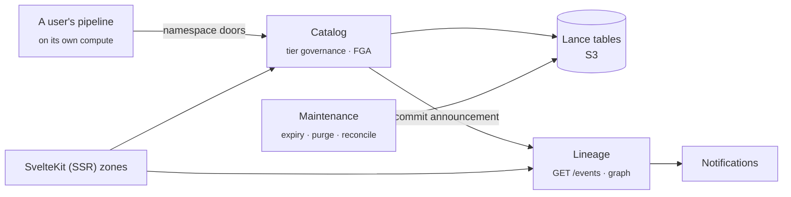

# rask

**rask** is an agnostic, multimodal lakehouse: Lance tables governed by a catalog, with lineage, authorization,
events and annotation across them. Any modality (text, image, audio, video, embeddings) is a first-class citizen:
bytes in, a governed table out, lineage emitted. The lakehouse runs no compute and no workflow engine of its own;
every write, from whatever engine the user brings, comes in through the catalog's Lance Namespace doors.

It is a polyglot monorepo — **Python + Svelte/TypeScript**, managed with
[uv](https://docs.astral.sh/uv/) (Python 3.13) and [Bun](https://bun.sh) — split
into two language-pure planes: the Python plane (reusable **`packages/`**
libraries plus runnable **`services/`**) and the JS/TS plane under
**`frontend/`**, its own Bun + Turborepo workspace root. Deployables build from
the root workspace (`uv sync --package <name>`), one dockerfile each under
`.docker/`, and Dagger builds every image.

## What it does

1. A client (the user's pipeline, an ingest job, a notebook) writes through the catalog's **Lance Namespace** doors;
   the catalog authorizes it on **OpenFGA** and governs the bronze → silver → gold tiers in its own write path.
2. The catalog announces every committed write as an **OpenLineage** event; lineage records it and serves the
   durable `GET /events` feed a pipeline polls, and **notifications** tells the right person.
3. **Maintenance** expires versions, purges trash, scans for orphans and reconciles stores.
4. The **SvelteKit** zones read the catalog, lineage and the media services (viewer, search, annotator) through the
   gateway on `:8888`.

## Where to go next

- **[Getting Started](getting-started/index.md)** — install, run it locally, and deploy to k3s.
- **[Architecture](architecture/index.md)** — how the catalog, lineage, maintenance, the zones and storage fit together.
- **[Tier Governance](TIER-GOVERNANCE.md)** — what the catalog enforces on a write into a tier.
- **[Packages](packages/index.md)** — the monorepo's libraries.
- **[API Reference](reference/storage.md)** — auto-generated from source docstrings.

!!! note "Audience"
    These docs describe the system as it is. Decisions and their history are in the
    [decision records](adr/README.md).
