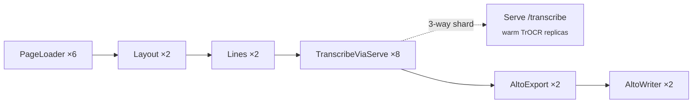

# htr runner

A sealed workload: handwritten-text recognition, page images in, ALTO 4.4 XML out. The project holds
two packages side by side:

- `src/runner` — the Ray Data batch driver (`runner` CLI), its pipelines, and the Ray Serve
  applications that keep model weights warm across jobs.
- `src/htr` — the library the pipelines are built from: Ray Data actors, the schemas that flow
  between them, the ALTO serializer, and geometry helpers.

It is deliberately **not** a uv workspace member. It carries its own `pyproject.toml` and its own
`uv.lock`, so its model stack (torch, htrflow, ultralytics, transformers, opencv) never enters the
fleet's resolution; `storage` comes in as a path dependency. Its tests run as their own leg of
`make test` (`cd runners/htr && uv run --frozen pytest -m "not slow"`), because the root pytest can
neither import nor collect them. Its Ray image is built from the parametrized
`.docker/ray-runner.dockerfile`:

```bash
bash scripts/dagger-image.sh --runner htr --tag ray-htr:<tag>
```

No YAML and no custom Stage/Runner kernel: each pipeline is a thin `ray.data.map_batches` chain.

## Usage

```bash
# Local mode (single process, no cluster)
uv run --project runners/htr runner --input ./images --output ./alto --pipeline fake

# Against MinIO / HCP
uv run --project runners/htr runner \
    --input s3://images-batch \
    --output s3://images-batch-alto \
    --prefix A0060198/ \
    --pipeline htr

# IIIF batches through the S3 read-through cache
uv run --project runners/htr runner --output s3://images-batch-alto \
    --pipeline htr --batch A0060198 --cache-bucket images-batch

# Against a Ray cluster
uv run --project runners/htr runner --input ... --output ... \
    --address ray://dev-kuberay.ra.se:10001
```

## Flags

| Flag | Default | Meaning |
|---|---|---|
| `--output`, `-o` | *(required)* | Filesystem path or `s3://bucket[/prefix]` for ALTO output. |
| `--input`, `-i` | — | Filesystem path or `s3://bucket`. Mutually exclusive with `--batch`. |
| `--batch` | — | IIIF batch ID (repeatable). Implies the read-through cache; requires `--cache-bucket`. |
| `--cache-bucket` | — | S3 bucket used as the IIIF cache (required with `--batch`). |
| `--iiif-url` | `https://iiifintern-ai.ra.se` | IIIF server base (env `IIIF_URL`). |
| `--pipeline` | `htr` | `htr` / `htrflow` / `prefetch` / `fake` — see [Pipelines](#pipelines). |
| `--prefix` | `""` | Key prefix scoping both source listing and sink resumability. |
| `--limit`, `-n` | — | Process only the first N keys after the resume diff. |
| `--s3-endpoint` | — | HCP/S3 endpoint URL (env `HCP_ENDPOINT`). |
| `--address` | local | Ray address, e.g. `ray://dev-kuberay.ra.se:10001`; omit for local mode. |
| `--log-level` | `INFO` | `INFO`, `DEBUG`, etc. |
| `--profile` / `--torch-profile` | off | Ray Data per-operator stats + Chrome timeline / per-actor torch traces. |

## Resumability

The runner lists all input keys and all existing output `.xml` keys, and processes only the diff
(`--limit` truncates after the diff). Re-running a job after a crash resumes from where it stopped.
`prefetch` resumes against the cache bucket instead: it skips images already cached.

## Pipelines

`runner.pipeline.PIPELINES` is the registry; a name is the `--pipeline` value.

| Name | Shape | Stages |
|---|---|---|
| `htr` | actor-per-stage | PageLoader → Layout → Lines → TranscribeViaServe → AltoExport → AltoWriter |
| `htrflow` | single Serve deployment | PageLoader → HTRFlowViaServeBytes → AltoWriter |
| `prefetch` | single stage | PrefetchActor (IIIF → S3 cache warm) |
| `fake` | no-GPU smoke | PageLoader → FakeAltoActor → AltoWriter |

`htr` runs each step as its own actor pool and hands only TrOCR to Serve. `htrflow` hands the whole
page to one Serve deployment wrapping the upstream HTRflow pipeline (region YOLO → line YOLO → TrOCR →
ALTO), for when actor fan-out is not worth it for a batch shape. Both need their Serve application
deployed first — see [Serve applications](#serve-applications).

**GPU sizing is hardcoded for a 3-GPU node** in `pipeline.py`: Layout/Lines take token `0.001` GPU
fractions (a placement token that lands them on the GPU node); the heavy TrOCR work is decoupled onto
a Ray Serve deployment so weights stay warm across jobs. Pools use `ActorPoolStrategy(size=N)` with the
autoscaler **off** — `concurrency=(N,N)` biased all work to the first-warm actor and idled the other
GPUs. Changing target hardware means editing that file.



## Serve applications

| Application | Module | Route |
|---|---|---|
| `transcribe` | `runner/transcribe_service.py` (`TranscribeService`) | `/transcribe` |
| `htrflow` | `runner/htrflow_service.py` (`HTRFlowDeployment`, bound as `htrflow_app`) | `/htrflow` |

Both are deployed separately with this runner's own script (`make serve-up` / `serve-down` /
`serve-status` wrap it):

```bash
uv run --project runners/htr python runners/htr/scripts/deploy_serve.py up                  # transcribe
uv run --project runners/htr python runners/htr/scripts/deploy_serve.py up --app htrflow    # full pipeline
uv run --project runners/htr python runners/htr/scripts/deploy_serve.py status              # all apps
```

Replica and GPU sizing is env-driven: `RASK_SERVE_REPLICAS` (default 2) and `RASK_SERVE_GPU_FRAC`
(default 0.49) for both; `RASK_SERVE_MEMORY_GB` (default 4) is the transcribe replica's declared
memory, and `RASK_SERVE_GPU_RESOURCE` optionally pins the htrflow replica to a GPU tier. Both
pipeline-side callers (`TranscribeViaServe`, `HTRFlowViaServeBytes`) shard each task three ways to
keep all GPU replicas busy.

**Both applications on the 2-GPU pool** (`make ray-up-htr`, GPUs 0,1): the defaults co-reside them as
2 apps × 2 replicas × 0.49 GPU = 1.96 GPU, leaving headroom for the `htr` pipeline's `0.001` Layout/Lines
tokens. The pool is started with `RAY_ENABLE_UV_RUN_RUNTIME_ENV=0` and an unsynced `uv run`, and the
deploys match it:

```bash
RAY_ENABLE_UV_RUN_RUNTIME_ENV=0 uv run --project runners/htr --no-sync python runners/htr/scripts/deploy_serve.py up --app transcribe
RAY_ENABLE_UV_RUN_RUNTIME_ENV=0 uv run --project runners/htr --no-sync python runners/htr/scripts/deploy_serve.py up --app htrflow
```

For a single CPU or 1-GPU host, deploy `htrflow` alone with one replica:
`RASK_SERVE_REPLICAS=1 RAY_ENABLE_UV_RUN_RUNTIME_ENV=0 uv run --project runners/htr --no-sync python runners/htr/scripts/deploy_serve.py up --app htrflow`.

`/htrflow` also answers plain HTTP: `POST` the raw image bytes (no envelope) and it returns the page's
ALTO XML; `?name=` sets the ALTO `fileName`.

In a cluster, a deployment declares the application in its chart values under
`ray.serveApplications[]` — `name`, `importPath` (e.g. `runner.htrflow_service:htrflow_app`),
`routePrefix`, and `image`, the `ray-htr` image built above. `image` renders into
`runtime_env.image_uri`, so these replicas run this runner's environment while the head stays
agnostic. The platform chart declares no application by default, so the declaration lives in the
deployment's own values overlay:

```yaml
ray:
  serveApplications:
    - name: htrflow
      importPath: "runner.htrflow_service:htrflow_app"
      routePrefix: "/htrflow"
      image: "<registry>/ray-htr:<tag>"   # k3s side-loads ray-htr:dev, so a bare tag resolves there
```

## The `htr` library (`src/htr`)

The library is **hardware-agnostic**: pool sizes and GPU fractions are applied by `runner/pipeline.py`,
not baked into the actors.

### Public API

`from htr import …` exposes **only the schemas** (frozen dataclasses): `PageImage`, `Region`, `Line`,
`Word`, `TranscribedLine`, `PageWithRegions`, `PageWithLines`, `PageWithText`. Actors and helpers are
imported from their submodules (`htr.actors.layout`, `htr.alto.serialize`, `htr.geometry`).

### Actors

Each actor is a config-only class that lazily loads its model on first call and maps
`dict[str, np.ndarray]` batches (one row per page).

| Actor | Module | Role | Resource |
|---|---|---|---|
| `PageLoaderActor` | `actors/io.py` | Read bytes from a `storage.Source` (16-thread GET pool); validate with PIL, drop unreadable pages. | CPU / network |
| `PrefetchActor` | `actors/io.py` | Cache-warmer — calls `source.read` for the IIIF → S3 write-through side effect. | CPU / network |
| `LayoutActor` | `actors/layout.py` | YOLO region detection (`REGION_MODEL`). | `num_gpus=0.001` |
| `LineActor` | `actors/lines.py` | YOLO line detection within each region crop (`LINE_MODEL`); stores absolute polygons when the model emits masks; sorts by `(y, x)`. | `num_gpus=0.001` |
| `TranscribeActor` | `actors/transcription.py` | In-process TrOCR (bypassed in production — see below). | GPU |
| `AltoExportActor` | `actors/alto_export.py` | Regroup transcribed lines under regions, build `PageWithText`, serialize ALTO. | CPU |
| `AltoWriterActor` | `actors/io.py` | Write each `(output_key, alto_xml)` to a `storage.Sink`. | CPU |
| `FakeAltoActor` | `actors/fake.py` | Emit stub ALTO for no-GPU smoke tests. | CPU |

**Transcription runs on Ray Serve, not in-actor.** The `htr` pipeline uses `TranscribeViaServe`
(`runner/transcribe_service.py`) in place of `TranscribeActor`: a CPU-only step that crops and
length-buckets lines and calls the warm TrOCR Serve deployment over a handle. `TranscribeActor` and
`TranscribeService` share model-setup code, including a transformers ≥ 5.6 meta-tensor workaround for
the TrOCR positional embedding.

### Schemas

The logical flow is `PageImage → PageWithRegions → (lines) → PageWithText`. Actors pass **parallel
object-dtype columns** (`key`, `image_bytes`, `regions`, `lines`, `transcribed`, `output_key`,
`alto_xml`) where list-valued columns are pickle blobs (`_columns.py`); `PageWithText` is
reconstructed only inside `AltoExportActor`.

Key fields: `Region(x, y, w, h, confidence, label, polygon)`,
`Line(x, y, w, h, abs_x, abs_y, abs_polygon, confidence)`, `TranscribedLine(line, text, confidence, words)`.

### ALTO serialization

`htr.alto.serialize.serialize_alto(page_with_text, *, emit_words=True, models=PIPELINE_MODELS)` renders
**ALTO 4.4** via a Jinja2 template (`alto/templates/alto-4-4`) and records the models it names in the
document. Lines emit a real `<Shape><Polygon>` when `abs_polygon` is present, else the four bbox
corners. Word boxes come from `alto/word_segment.py` — **geometric** segmentation (splitting line
width by character count), not a model. Line/page confidence is `exp(mean per-token log-prob)`.

### Geometry & preprocessing

- `htr/geometry.py` — `Point`, `Bbox`, `Polygon`, plus mask ↔ polygon ↔ bbox converters
  (`mask2polygon` uses contour + Douglas-Peucker).
- `htr/preprocessing.py` — YOLO/RTMDet letterboxing, TrOCR normalization, `crop_region` /
  `crop_polygon`.
- `htr/reading_order.py` — printspace + two-page reading-order estimation (ported from htrflow;
  **not wired** into the actor path).

### Gotchas

- **Model identities are declared once**, in `htr/models.py` (`REGION_MODEL`, `LINE_MODEL`,
  `TEXT_MODEL`), and read by the actors, the pipeline and the ALTO serializer. The revision is `main`
  unless `RASK_HTR_MODEL_REVISION` pins one; whatever it resolves to is written into the ALTO.
- **The YOLO `.pt` is fetched via `hf_hub_download`** (Ultralytics cannot resolve HF repo IDs). The
  private TrOCR model needs `HF_TOKEN` on deployed clusters.
- **Resource hints live in the runner** (`pipeline.py`), not in the library — `num_gpus`, pool sizes,
  `batch_size`.
- **Line ordering happens twice** with different logic (`LineActor` sort vs. `AltoExportActor`
  containment regroup).
